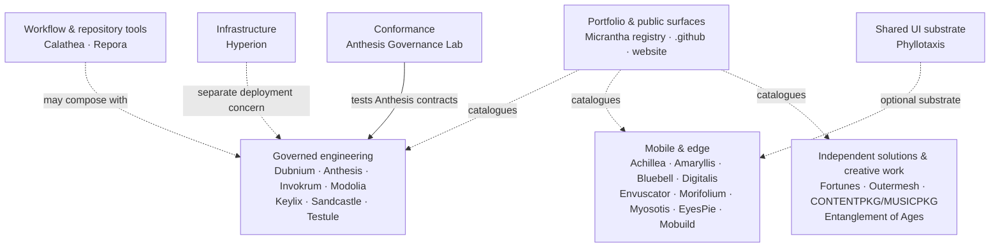
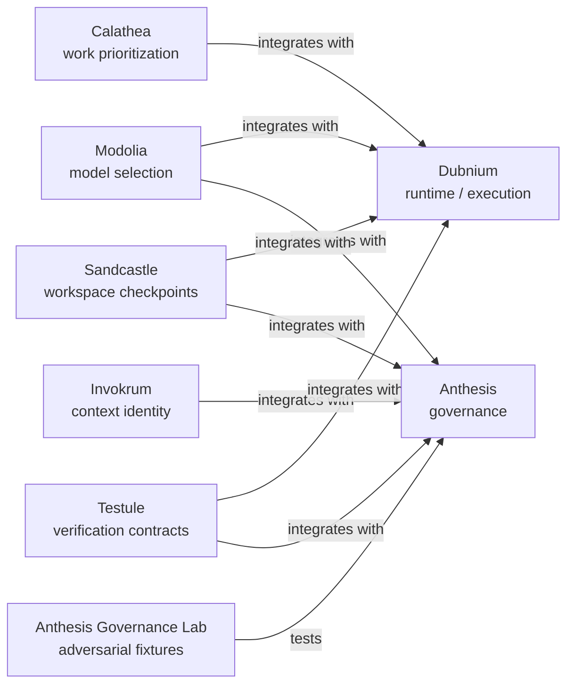
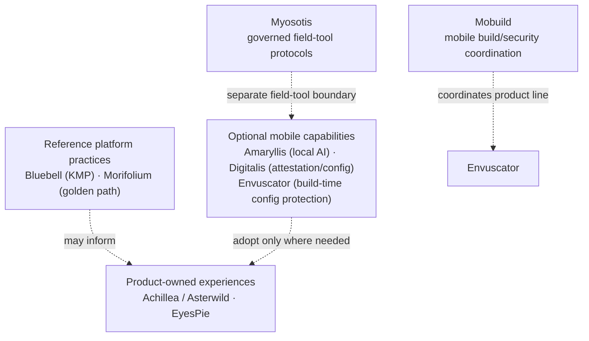

# How Micrantha projects fit together

Micrantha is a **portfolio of independently owned systems**, not a single deployable application or a mandatory dependency chain. This map is a public navigation view of responsibilities and documented relationships. It distinguishes registered relationships from possible compositions; it is **not** a live service topology or an assertion that every integration is implemented.

Start with the [organization overview](../../profile/README.md#project-families), then follow a project link below for its architecture, maturity, releases, and integration evidence. The [repository responsibility catalogue](./repository-catalogue.md) explains ownership and non-responsibilities. Project identity and declared relationships are maintained in the canonical Micrantha registry; this page is a reviewed public projection, not a second registry.

## At a glance

The dashed connections in this overview are **family-level context**, not implementation dependencies. The independent projects at the right of the portfolio do not need to be connected to the governed-engineering stack to remain first-class projects.

Jump to [governed engineering](#governed-engineering), [infrastructure and repository operations](#infrastructure-and-repository-operations), [mobile and edge](#mobile-and-edge), [shared UI and independent projects](#shared-ui-and-independent-projects), or [integration rules](#reading-and-maintaining-this-map).

## Governed engineering

This is the portion with the clearest declared cross-project relationships. Solid arrows below represent a relationship **recorded in the canonical project registry**. They do *not* by themselves establish runtime adoption, production availability, compatibility, or authority.

| Component | Owns | Drill down |
| --- | --- | --- |
| Dubnium | Bounded execution, supervisor/runtime, run observations and local operating environment | [Public concepts](https://github.com/hackelia-micrantha/dubnium-community) |
| Anthesis | Policy, approvals, governed-action decisions, provenance, and trusted-state transitions | [Contracts and examples](https://github.com/hackelia-micrantha/anthesis-community) |
| Invokrum | Reproducible prompt/context packaging and exact invocation identity | [Public contracts](https://github.com/hackelia-micrantha/invokrum-community) |
| Modolia | Deterministic model eligibility and selection, not provider execution | [Public contracts](https://github.com/hackelia-micrantha/modolia-community) |
| Keylix | OAuth/DPoP sender binding and proof-of-possession primitives where adopted | [Public contracts](https://github.com/hackelia-micrantha/keylix-community) |
| Sandcastle | Checkpoint and mutable-workspace identity/lineage, not semantic correctness | [Public contracts](https://github.com/hackelia-micrantha/sandcastle-community) |
| Testule | Portable verification/testability contracts and evidence normalization, not test-runner execution | [Public contracts](https://github.com/hackelia-micrantha/testule-community) |
| Calathea | Deterministic work/portfolio prioritization; private portfolio data is a separate surface | [Reusable core](https://github.com/hackelia-micrantha/calathea-community) |
| Anthesis Governance Lab | Independent scenarios and adversarial evaluation, not production enforcement | [Testbed](https://github.com/ryjen/anthesis-governance-lab) |

**Critical boundary:** Dubnium execution evidence, Invokrum context identity, Modolia model decisions, Keylix sender proof, Sandcastle checkpoints, Testule results, and Calathea priority decisions do **not** confer Anthesis approval or runtime effect authority. Anthesis decisions require a capable enforcement boundary; a diagrammed connection is not a proof that bypass paths are controlled. See [authority relationships](./repository-catalogue.md#authority-relationships).

## Infrastructure and repository operations

These tools can support other projects, but are not a second agent-governance control plane.

| Project | Integration boundary | Drill down |
| --- | --- | --- |
| Hyperion | Provisioned K3s/GitOps infrastructure; Dubnium separately owns workstation and local agent runtime. Their interoperability is optional. | [Infrastructure concepts](https://github.com/hackelia-micrantha/hyperion-community) |
| Repora | Explicit repository topology, reviewed plans, stale-safe reconciliation and repository evidence. It does not invent authorization from repository labels. | [Repository tooling](https://github.com/hackelia-micrantha/repora) |
| .github | Shared engineering standards, security guidance, prompts and contributor defaults; not project implementation or an inherited runtime policy engine. | [Engineering standards](../standards/README.md) |
| Micrantha meta | Canonical project identities and relationships, skill/adoption coordination and aggregate status; does not execute projects. | [Public responsibility catalogue](./repository-catalogue.md) |
| Micrantha web | Evidence-backed public presentation of projects; does not establish project maturity by assertion. | [Website](https://micrantha.com) |

## Mobile and edge

The mobile work is a **menu of separately owned capabilities**, not a framework all mobile apps must import. This is an illustrative composition diagram, **not** a claim of verified dependencies.

| Project | Responsibility | Drill down |
| --- | --- | --- |
| Achillea | Guided outdoor experience SDK/platform; Asterwild is its first consumer | [Community surface](https://github.com/hackelia-micrantha/achillea-community) |
| Amaryllis | React Native APIs for on-device inference and AI-enabled UI | [Project repository](https://github.com/hackelia-micrantha/amaryllis) |
| Bluebell | Kotlin Multiplatform SDK/application structure | [Project repository](https://github.com/hackelia-micrantha/bluebell) |
| Digitalis | Attestation and protected configuration delivery experiments | [Community surface](https://github.com/hackelia-micrantha/digitalis-community) |
| Envuscator | Build-time mobile configuration obfuscation and native integration | [Public documentation](https://github.com/hackelia-micrantha/envuscator-community) |
| Morifolium | Versioned mobile engineering golden path and reference distribution | [Ownership catalogue](./repository-catalogue.md#laboratory-infrastructure-templates-and-reference-integrations) |
| Myosotis | Device-local governed field-tool protocols, consent, provenance and failure contracts | [Community surface](https://github.com/hackelia-micrantha/myosotis-community) |
| EyesPie | Computer-vision game / cross-platform application testbed | [Ownership catalogue](./repository-catalogue.md#laboratory-infrastructure-templates-and-reference-integrations) |
| Mobuild | Architecture and coordination for mobile build/security components, currently including Envuscator | [Ownership catalogue](./repository-catalogue.md#additional-registered-project-boundaries) |

Envuscator's build-time obfuscation is not Digitalis attestation. Neither supplies general application authorization. Product apps choose and verify any integration themselves.

## Shared UI and independent projects

**[Phyllotaxis](https://github.com/hackelia-micrantha/phyllotaxis-community)** provides shared themeable UI contracts (including Venation); projects remain responsible for their own designs, content and implementation. Reuse is not mandatory or proof of adoption.

Several projects are independently useful and should not be forced into the governed-agent or mobile execution graph:

| Project | Standalone purpose | Drill down |
| --- | --- | --- |
| Fortunes Service | UNIX-fortunes service and web/Slack delivery | [Catalogue](./repository-catalogue.md#solutions-platforms-and-product-systems) |
| Outermesh | Learning through a bounded multiplayer security-simulation game | [Catalogue](./repository-catalogue.md#additional-registered-project-boundaries) |
| CONTENTPKG / MUSICPKG | Experimental content packaging and owner-bound digital music interoperability | [MUSICPKG public specification](https://github.com/hackelia-micrantha/musicpkg-community) |
| Entanglement of Ages | Creative publishing with separately reviewed public marketing | [Public marketing](https://github.com/ryjen/entanglement-of-ages-marketing) |

## Reading and maintaining this map

- **Registered relationship**: the directed, named link exists in the canonical project registry. This indicates intended project-level integration scope, **not** a completed deployment.
- **Illustrative or optional composition**: a boundary described by the public responsibility catalogue; validate adoption and compatibility in the *consumer's* repository.
- **Missing arrow**: no claim of dependency is made. An omitted project is not necessarily unused.
- **Public/community link**: may expose contracts, examples or projections without implementation source or an available product release.
- **Authority**: source ownership, verification, identity, approval, execution, promotion and publication remain distinct. No link or topology diagram delegates them.

For exact project identity, role, lifecycle and declared `relationships`, use the Micrantha meta registry (available to its authorized maintainers). For a public ownership and maturity explanation, use the [repository responsibility catalogue](./repository-catalogue.md). For implemented integrations, versions, CI/evidence and operational status, **follow the owning project repository**; update the registry before making a new cross-project relationship canonical.
