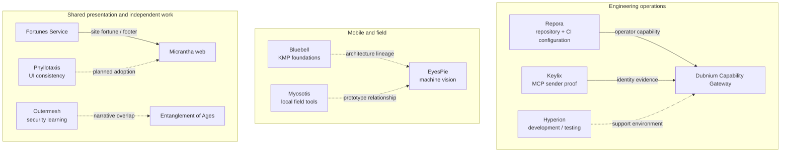
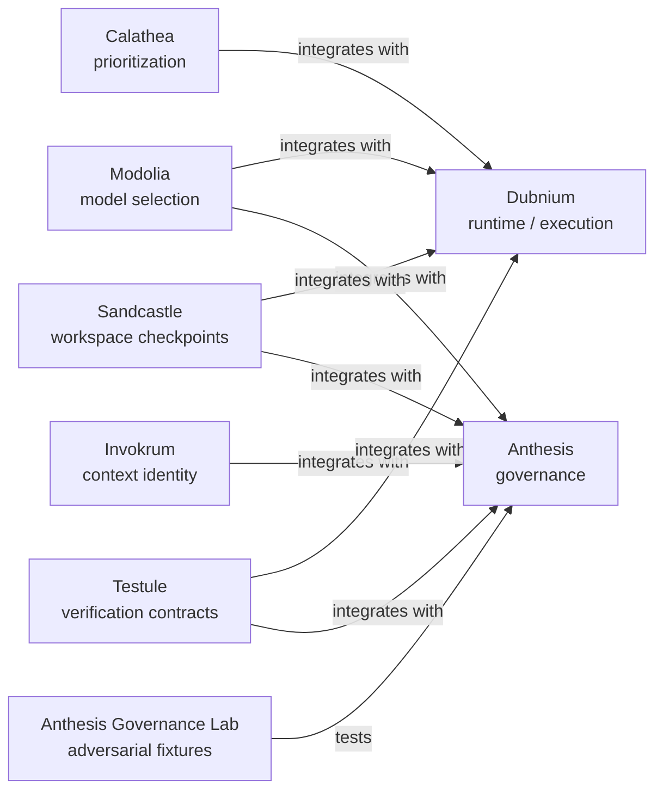
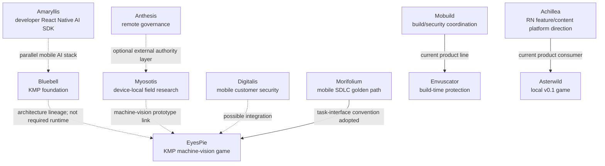
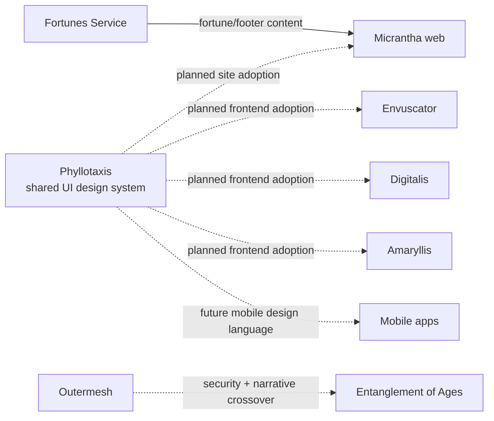

# How Micrantha projects fit together

Micrantha is a portfolio of **separately owned projects** with shared engineering infrastructure, optional SDKs, and some concrete cross-project consumers. It is not one deployable application or a mandatory dependency stack. This page maps *relationships*, not simply repository proximity.

Start with the [organization profile](../../profile/README.md#project-families), then drill into the [responsibility catalogue](./repository-catalogue.md), public project surfaces, and implementation evidence linked below. [Canonical project identities and explicitly declared relationships](https://github.com/hackelia-micrantha/hackelia-micrantha/blob/main/registry/projects.yaml) live in the Micrantha meta registry; this page does not replace it.

**Reading the edges:** solid arrows in the governed-engineering graph are registry declarations (not runtime-completion evidence). Other solid arrows indicate documented or owner-reported *use*, qualified in the text. Dashed arrows indicate architectural lineage, optional/planned integrations, or conceptual overlap. A project can be important without an arrow.

## At a glance

This is a **selective relationship map**, not a complete runtime topology. For additional declared governed-engineering relationships see below. For mobile components and creative/distribution products, follow their sections rather than interpreting omission as nonexistence.

Jump to [governed engineering](#governed-engineering), [infrastructure and repository operations](#infrastructure-and-repository-operations), [mobile and edge](#mobile-and-edge), [frontends and independent projects](#frontends-and-independent-projects), or [relationship maturity](#relationship-maturity-and-open-reconciliation).

## Governed engineering

The following **solid edges** are the nine directed relationships declared in the canonical registry; they identify a project-level integration or testing contract, not proof that a production effect path is deployed.

| Project | What it owns / relationship | Evidence and drill-down |
| --- | --- | --- |
| Dubnium | Local runtime, bounded execution, Supervisor, Gateway and operations; execution receipts are not governance authority | [Public concepts](https://github.com/hackelia-micrantha/dubnium-community) |
| Anthesis | Policy, approvals, governed-action decisions, provenance and trusted-state transitions | [Contracts](https://github.com/hackelia-micrantha/anthesis-community) |
| Calathea | Work/portfolio prioritization, which does not authorize execution | [Reusable core](https://github.com/hackelia-micrantha/calathea-community) |
| Invokrum | Reproducible prompt/context identity, not execution or permission | [Contracts](https://github.com/hackelia-micrantha/invokrum-community) |
| Modolia | Model eligibility/selection; provider execution remains outside it | [Contracts](https://github.com/hackelia-micrantha/modolia-community) |
| Sandcastle | Checkpoint/workspace lineage, not semantic correctness | [Contracts](https://github.com/hackelia-micrantha/sandcastle-community) |
| Testule | Testability requirements and normalized evidence, not a second test runner | [Contracts](https://github.com/hackelia-micrantha/testule-community) |
| Anthesis Governance Lab | Independent adversarial conformance evaluation | [Testbed](https://github.com/ryjen/anthesis-governance-lab) |
| Keylix | OAuth/DPoP sender binding for MCP-facing Gateway requests; **sender proof is neither authentication policy nor authorization** | [Integration contract](https://github.com/hackelia-micrantha/keylix-community) · [Gateway adapter source](https://github.com/ryjen/dubnium/blob/main/pkgs/capability-gateway-go/keylix_binding_client.go) |
| Repora | Repository and CI/CD configuration management exposed to the engineering environment as a bounded operator capability (operator-reported use); independent reconciliation and effect permissions still apply | [Repo control tool](https://github.com/hackelia-micrantha/repora) · [Dubnium repoctl composition](https://github.com/ryjen/dubnium/blob/main/modules/tools/repoctl.nix) |

**Authority boundary:** Keylix sender binding, Repora plans, Invokrum contexts, Modolia routes, Sandcastle checkpoints, Testule results and Dubnium run evidence do not confer Anthesis approval or authorize a Gateway effect. Repora's actual Gateway action admission, and Keylix verifier deployment/qualification, must be checked against the current runtime before claiming any given end-to-end production integration. See [governed execution boundaries](./repository-catalogue.md#governed-agentic-execution).

## Infrastructure and repository operations

| Project / surface | Current role and limits | Drill down |
| --- | --- | --- |
| Hyperion | Operator-reported **development and testing** infrastructure; not externally exposed at present. GitOps owns workload convergence, while Dubnium owns its local execution/runtime boundary. Do not infer public ingress or production hosting from environment names. | [Infrastructure contracts](https://github.com/hackelia-micrantha/hyperion-community) |
| Repora | Repository topology, CI/CD posture/configuration and controlled reconciliation through reviewable plans; repository metadata is not authorization | [Repo control](https://github.com/hackelia-micrantha/repora) |
| .github | Shared guidance, prompts, security conventions and contributor standards, not repository-local implementation | [Standards](../standards/README.md) |
| Micrantha meta | Canonical project identity, lifecycle, declared relationships and portfolio coordination | [Registry](https://github.com/hackelia-micrantha/hackelia-micrantha/blob/main/registry/projects.yaml) |
| Micrantha Web | Public portfolio presentation and site features; projects remain their own sources of truth | [Website repository](https://github.com/hackelia-micrantha/web) |

## Mobile and edge

These are *related* technologies but not one shared runtime. In particular, a KMP architecture lineage or testbed relationship does not mean the current application imports that project's SDK.

| Project | Relationship / actual boundary | Status and drill-down |
| --- | --- | --- |
| Bluebell | KMP architectural foundation for EyesPie; current EyesPie Wayfinder intentionally avoids the historical broad Bluebell runtime dependency | [EyesPie architecture](https://github.com/ryjen/eyespie/blob/main/ARCHITECTURE.md) |
| EyesPie | Local-authoritative, machine-vision game and prototype relevant to Myosotis field-tool research | [Current implementation](https://github.com/ryjen/eyespie) |
| Myosotis | **Local-first** field research: device-owned consent, policy, execution and audit. Anthesis may provide *optional remote governance* without overriding local enforcement; EyesPie is a related machine-vision prototype, not a verified SDK consumer | [Protocol and SDK plans](https://github.com/hackelia-micrantha/myosotis-community) |
| Amaryllis | Independent **developer-facing React Native** on-device AI SDK, adjacent to Bluebell/EyesPie but not a KMP dependency | [SDK](https://github.com/hackelia-micrantha/amaryllis) |
| Digitalis | Mobile security/attestation and protected configuration for customers; **optional future EyesPie adoption**, not current EyesPie infrastructure | [Public contracts](https://github.com/hackelia-micrantha/digitalis-community) |
| Envuscator / Mobuild | Envuscator protects mobile build-time configuration; Mobuild coordinates engine, provider adapters, entitlement, distribution and customer-runner boundaries. It is **not** Digitalis attestation | [Envuscator documentation](https://github.com/hackelia-micrantha/envuscator-community) |
| Morifolium | Mobile SDLC golden-path work; EyesPie adopted its narrow `mise run ci` convention in a validated second-consumer exercise. **Operator reports the broader project has gone stale**, while its registry still says incubating; reassess before promising active delivery or changing canonical lifecycle | [Adoption evidence](https://github.com/hackelia-micrantha/morifolium/blob/main/docs/adoption/eyespie.md) |
| Achillea / Asterwild | Owner's broader direction includes **feature-enabled downloads for React Native**. Its *current* repository contract instead focuses on local Asterwild/Pentalpha SDK/game packages; no downloadable-feature runtime is claimed shipped. Reconcile the product/platform roadmap before changing the canonical description | [Current v0.1 scope](https://github.com/hackelia-micrantha/achillea/blob/main/README.md) |

## Frontends and independent projects

| Project | Relationship / purpose | Drill down |
| --- | --- | --- |
| Phyllotaxis | Planned shared look and feel across Micrantha frontends, starting with **Web, Envuscator, Digitalis and Amaryllis**, and eventually mobile apps. Current implementation is a React-oriented UI package; mobile consistency does **not** imply a shipped native-mobile component library | [Public design contracts](https://github.com/hackelia-micrantha/phyllotaxis-community) |
| Fortunes Service | Serves fortune content used by the Micrantha web experience, including footer placement reported by the owner; web has a server-side Fortunes API adapter | [Web integration source](https://github.com/hackelia-micrantha/web/blob/main/app/services/fortune.server.ts) |
| Outermesh | Security-learning project with crossover into book-writing and themes explored in Entanglement of Ages; **conceptual overlap**, not a code/release dependency | [Project](https://github.com/hackelia-micrantha/outermesh) |
| CONTENTPKG / MUSICPKG | Research into distributing music and, eventually, books in an owner-respecting way. MUSICPKG has published draft interoperability contracts; BOOKPKG is **proposed**, not a released Entanglement of Ages publishing integration | [Published MUSICPKG specification](https://github.com/hackelia-micrantha/musicpkg-community) |
| Entanglement of Ages | Author's creative exploration of humanity; its writing and marketing authority are independent from software platform and security-tooling authority | [Public marketing](https://github.com/ryjen/entanglement-of-ages-marketing) |

## Relationship maturity and open reconciliation

- **Declared in registry:** governed-engineering edges in the second graph. These are *project relationships*, not proof of installed adapters or successful effect execution.
- **Observed in source:** Keylix Gateway adapter, Dubnium repoctl composition, the Micrantha Web Fortunes API call and the Morifolium/EyesPie task-adoption record. Each observation has the scope stated above.
- **Owner-reported current use:** Repora as a repository/CI configuration capability, Hyperion for private development/testing, and Fortunes in the site's footer. Runtime exposure and exact revisions require separate operational evidence.
- **Planned/optional:** Phyllotaxis adoption, mobile Digitalis adoption, optional remote Anthesis governance for Myosotis, and Achillea downloadable-feature direction.
- **Conceptual/lineage:** Bluebell's EyesPie KMP foundations, Myosotis/EyesPie research overlap, React Native/KMP SDK adjacency, and Outermesh/Entanglement of Ages themes. These are not package dependencies.
- **Needs project-owner reconciliation:** Achillea's current local-game focus versus downloadable-feature ambition; Morifolium's stale operating state versus incubating registry lifecycle. Do not rewrite project contracts or manufacture new `integrates_with` entries merely to draw an arrow.

For concrete adoption and compatibility, follow the **consuming project's** architecture, version pins, tests and release evidence. The canonical meta registry owns project identity and declared relationships; this reviewed public document is a human-facing integration guide, not another registry or approval authority.
