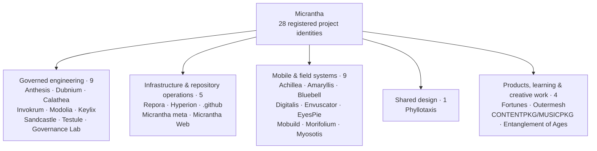
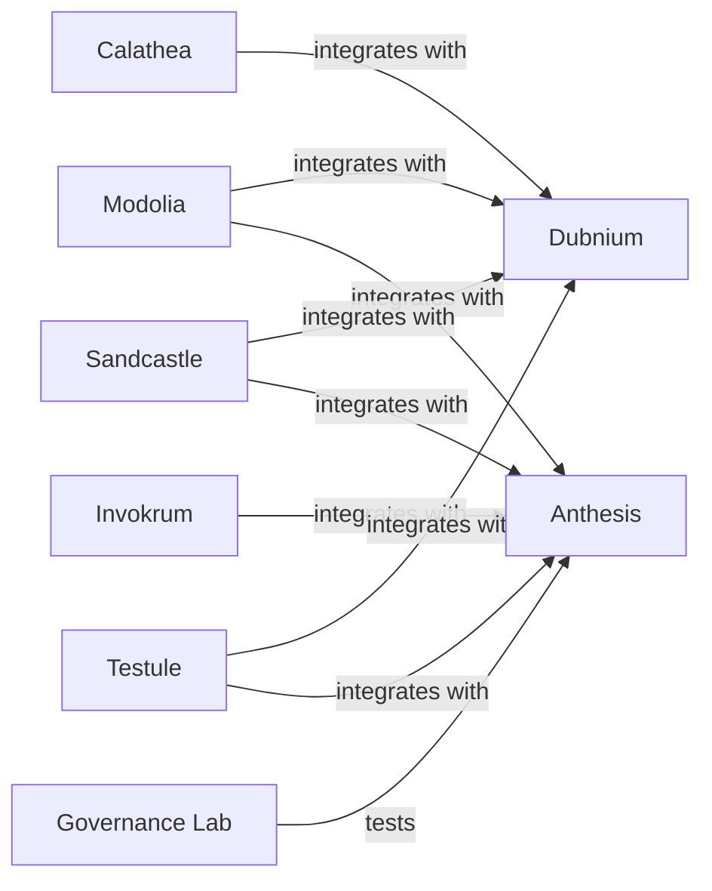
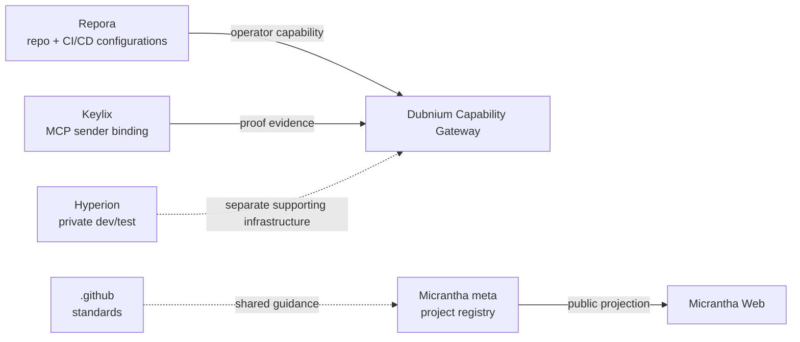
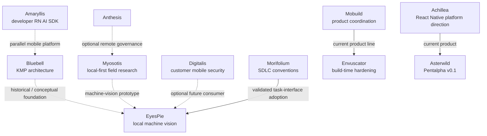
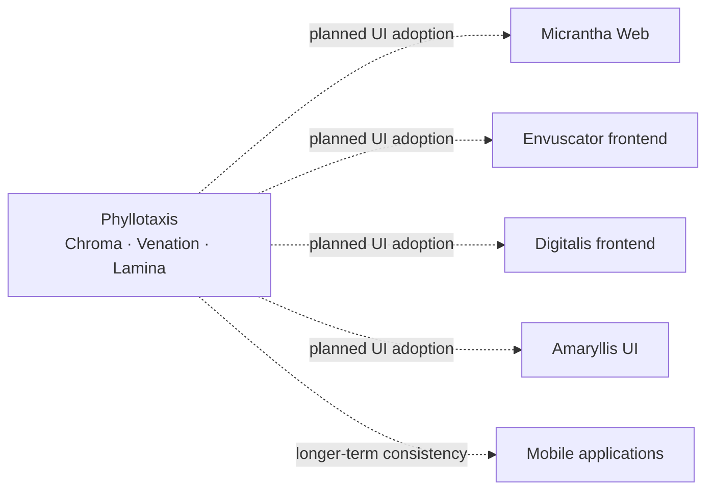
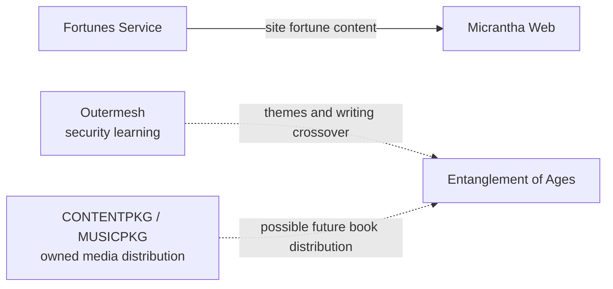

# How Micrantha projects fit together

Micrantha has **28 registered project identities** across five functional categories. Each project owns a distinct contract; the organization is not one mandatory deployable stack. This map is a *navigation and relationship guide*, not a second project registry, a live service topology, or a release-status dashboard.

**Drill-down path:** [organization profile](../../profile/README.md#project-families) → category below → project entry → linked owner documentation and implementation evidence. The [repository responsibility catalogue](./repository-catalogue.md) explains deeper ownership boundaries. Canonical project identity, lifecycle, and declared relationships remain in the private Micrantha meta registry, accessible to authorized maintainers; public descriptions here do not override it.

**How to read the evidence:** **Registry-declared** means a named relationship exists in the canonical registry, not that it is deployed. **Source-observed** means a bounded implementation or adoption is visible in the cited source. **Owner-reported** reflects current operator intent/use without independent runtime qualification. **Planned** and **conceptual** are not implemented dependencies. **Independent** means no ecosystem dependency is asserted.

## At a glance: all 28 registered projects

These are **portfolio groupings, not dependency edges**. For actual cross-category relationships, inspect the project tables and the more specific diagrams below.

| Category | Projects | Drill down |
| --- | ---: | --- |
| Governed engineering and SDLC | 9 | [Execution, authorization and evidence](#governed-engineering-and-sdlc-9) |
| Infrastructure, repository operations and portfolio | 5 | [Operations and public surfaces](#infrastructure-repository-operations-and-portfolio-5) |
| Mobile and field systems | 9 | [Mobile integration and application boundaries](#mobile-and-field-systems-9) |
| Shared interface and design system | 1 | [Design-system adoption](#shared-interface-and-design-system-1) |
| Products, learning and creative work | 4 | [Independent projects and real crossovers](#products-learning-and-creative-work-4) |

## Governed engineering and SDLC (9)

**Nine registry-declared edges** establish intended project relationships among this family. The solid edges below represent registry declarations, **not proof of production integrations**. Keylix and Repora have important additional relationships described in their entries, but those are not counted as new canonical registry edges.

| Registered project | Owns | Relationship / maturity | Project drill-down |
| --- | --- | --- | --- |
| **Anthesis** | Policy, approvals, governed-action interpretation, provenance and promotion | Registry target of Invokrum, Modolia, Sandcastle, Testule and Governance Lab. May provide optional **remote** Myosotis governance; that does not override device-local policy (**planned**). | [Anthesis contracts](https://github.com/hackelia-micrantha/anthesis-community) |
| **Dubnium** | Local AI/executor environment, Supervisor and Capability Gateway; runtime evidence | Registry target of Calathea, Modolia, Sandcastle and Testule; Keylix verifier and Repora repoctl compositions have bounded source evidence. No inferred effect authority. | [Dubnium public architecture](https://github.com/hackelia-micrantha/dubnium-community) |
| **Calathea** | Local-first deterministic prioritization and portfolio/work selection | Integrates with Dubnium (**registry-declared**); prioritization is advisory, not approval. | [Calathea reusable core](https://github.com/hackelia-micrantha/calathea-community) |
| **Invokrum** | Reproducible prompt/context composition, attestation and invocation identity | Integrates with Anthesis (**registry-declared**); Keylix may supply sender binding at ingress (**integration contract**, not general authorization). | [Invokrum contracts](https://github.com/hackelia-micrantha/invokrum-community) |
| **Modolia** | Deterministic model-surface eligibility and route decisions | Integrates with Dubnium and Anthesis (**registry-declared**); execution/provider effects remain owned elsewhere. | [Modolia contracts](https://github.com/hackelia-micrantha/modolia-community) |
| **Keylix** | OAuth/DPoP sender-constrained proofs and MCP HTTP adapter semantics | Integrates at Dubnium's MCP-facing Capability Gateway (**source-observed sender-binding client**); proof does **not** confer caller authorization or deployment qualification. | [Keylix public security contracts](https://github.com/hackelia-micrantha/keylix-community) |
| **Sandcastle** | Mutable-workspace checkpoints, identity and recovery lineage | Integrates with Dubnium and Anthesis (**registry-declared**); checkpoint evidence alone is not verified task success. | [Sandcastle contracts](https://github.com/hackelia-micrantha/sandcastle-community) |
| **Testule** | Testability plans, verification contracts and normalized test evidence | Integrates with Anthesis and Dubnium (**registry-declared**); doesn't supplant native test runners or independent acceptance. | [Testule contracts](https://github.com/hackelia-micrantha/testule-community) |
| **Anthesis Governance Lab** | Independent adversarial and deterministic governance tests | Tests Anthesis (**registry-declared**); not a production policy enforcement engine. | [Governance testbed](https://github.com/ryjen/anthesis-governance-lab) |

**Authority boundary:** Keylix sender proof, Repora repository plans, Invokrum context identities, Modolia routes, Sandcastle checkpoints, Testule receipts and Dubnium run evidence are not substitutes for current authorized Gateway effects and applicable Anthesis decisions. Consult the [governed-execution responsibility contract](./repository-catalogue.md#governed-agentic-execution).

## Infrastructure, repository operations and portfolio (5)

Solid arrows here describe **owner-reported usage/source-observed integration at limited scope**, not new registry declarations or a blanket production deployment claim.

| Registered project | Owns | Relationship / maturity | Project drill-down |
| --- | --- | --- | --- |
| **Repora** | Repository topology, read-only CI/CD posture, reviewed configuration plans and controlled reconciliation | Used as a repository and CI/CD management capability (**owner-reported**); Dubnium includes a repoctl operator-tool composition (**source-observed**). Exact Gateway effect admission still requires runtime evidence; repository labels don't authorize mutations. | [Repora](https://github.com/hackelia-micrantha/repora) |
| **Hyperion** | Reproducible K3s environments, IaC and Flux/GitOps workloads | Currently hosts **development/testing** work and is **not externally exposed** (**owner-reported**). Distinct from Dubnium workstation/runtime authority. | [Hyperion public concepts](https://github.com/hackelia-micrantha/hyperion-community) |
| **Micrantha GitHub Configuration (`.github`)** | Organization-wide prompts, engineering/security standards, templates and public profile | Shared guidance for repositories, **not** implicit project-local runtime policy or CI inheritance. This integration map lives here. | [Organization standards](../standards/README.md) |
| **Micrantha meta** | Canonical project identities, relationship metadata, portfolio/skill coordination | Authoritative registry (private); contributes reviewed data for public presentation. Does **not** execute project work. | [Public responsibility catalogue](./repository-catalogue.md) |
| **Micrantha Web** | Public website and portfolio presentation, including site-specific product integration | Consumes Fortunes content (**source-observed**) and is a planned first Phyllotaxis frontend consumer. | [Web application source](https://github.com/hackelia-micrantha/web) |

The meta repository's existing architecture diagram describes **governance and data ownership**, not this runtime integration map. The two views answer different questions.

## Mobile and field systems (9)

A solid arrow in this graph needs the **specific evidence and qualification in the table**, not the broader meaning of a registry `integrates_with` relationship.

| Registered project | Owns | Relationship / maturity | Project drill-down |
| --- | --- | --- | --- |
| **Achillea** | Reusable mobile gameplay/feature SDK and intended feature-enabled React Native downloads | Asterwild is its first current consumer; its **implemented v0.1** focuses on local Pentalpha. Feature-download direction is broader **owner intent**, not a shipped SDK capability. | [Achillea public product surface](https://github.com/hackelia-micrantha/achillea-community) |
| **Amaryllis** | Developer-facing React Native on-device AI SDK, offline multimodal interaction and governed UI primitives | Related to Bluebell/EyesPie as a **parallel React Native approach**, not an EyesPie SDK dependency; intended Phyllotaxis visual consistency is **planned**. | [Amaryllis SDK](https://github.com/hackelia-micrantha/amaryllis) |
| **Bluebell** | Reusable Kotlin Multiplatform architecture and SDK primitives | Architectural **foundation/lineage** for EyesPie. Current EyesPie Wayfinder does *not* require importing the older Bluebell runtime graph. | [Bluebell KMP SDK](https://github.com/hackelia-micrantha/bluebell) · [EyesPie architecture](https://github.com/ryjen/eyespie/blob/main/ARCHITECTURE.md) |
| **Digitalis** | Customer-oriented mobile attestation and protected-configuration delivery | May integrate with EyesPie (**optional, unimplemented there**). Distinct from Envuscator's static build-time hardening; Phyllotaxis UI adoption is planned. | [Digitalis public concepts](https://github.com/hackelia-micrantha/digitalis-community) |
| **Envuscator** | Mobile build-time configuration obfuscation, native engine and release verification | Product line coordinated by Mobuild; customer builds stay on customer-controlled runners. Phyllotaxis UI consistency is planned for its frontend, not its engine. | [Envuscator documentation](https://github.com/hackelia-micrantha/envuscator-community) |
| **EyesPie** | Device-local KMP machine-vision game, signed portable data and matching | Myosotis-related **field-vision prototype**; Bluebell architectural lineage, demonstrated Morifolium task convention; Digitalis is optional, not installed. | [EyesPie code and architecture](https://github.com/ryjen/eyespie) |
| **Mobuild** | Cross-repository mobile build/security architecture and component coordination | Currently coordinates Envuscator and its engine/provider/entitlement/public distribution boundaries; it is not a second hosted customer build service. | [Mobuild boundary in catalogue](./repository-catalogue.md#additional-registered-project-boundaries) |
| **Morifolium** | Versioned mobile SDLC golden-path conventions and reference project | `mise run ci` convention was adopted into EyesPie with recorded evidence (**verified narrow adoption**). **Owner reports the project stale**; registry still says incubating, so lifecycle reconciliation remains open. | [Evidence of EyesPie adoption](https://github.com/hackelia-micrantha/morifolium/blob/main/docs/adoption/eyespie.md) |
| **Myosotis** | **Local-first field research** protocols/SDK for governed device capabilities, consent, execution and audit | EyesPie is a machine-vision prototype relationship; Anthesis can add optional **remote** governance, without superseding device-local authority. No verified live coupling is claimed. | [Myosotis field protocol](https://github.com/hackelia-micrantha/myosotis-community) |

## Shared interface and design system (1)

| Registered project | Owns | Relationship / maturity | Project drill-down |
| --- | --- | --- | --- |
| **Phyllotaxis** | Micrantha-wide design language and reusable UI substrate | **Intended** to standardize most Micrantha frontend look and feel, starting with **Web, Envuscator, Digitalis and Amaryllis**, eventually extending to mobile apps. This does not imply existing adoption or a shipped native UI library. | [Public design requirements and contracts](https://github.com/hackelia-micrantha/phyllotaxis-community) |

## Products, learning and creative work (4)

The Fortunes-to-Web edge is supported by an actual server-side API consumer. The other edges describe **creative/product intent**, not dependencies or shipping integrations.

| Registered project | Owns | Relationship / maturity | Project drill-down |
| --- | --- | --- | --- |
| **Fortunes Service** | UNIX-fortunes service and web/Slack delivery | Fortune text appears in the Micrantha Web experience (including the footer, **owner-reported**); the site has a **source-observed** server-side Fortunes API consumer. | [Fortunes Service](https://github.com/hackelia-micrantha/fortunes-service) · [Web adapter](https://github.com/hackelia-micrantha/web/blob/main/app/services/fortune.server.ts) |
| **Outermesh** | Educational security-simulation game and software-engineering learning | Crosses into writing/security education and themes explored in Entanglement of Ages (**conceptual**, not code-level dependency). | [Public responsibility catalogue](./repository-catalogue.md#additional-registered-project-boundaries) |
| **CONTENTPKG / MUSICPKG** | Research and formats for owner-respecting distribution of music and potentially books | MUSICPKG v0.2 has published **draft** interoperability contracts; BOOKPKG remains **proposed**. No Entanglement of Ages release integration is established. | [MUSICPKG specification and conformance](https://github.com/hackelia-micrantha/musicpkg-community) |
| **Entanglement of Ages** | Creative exploration of the author's view of humanity, story and publishing | Thematic overlap with Outermesh and potential future book-distribution interest; authoritative writing and publishing decisions are independent of those software projects. | [Public marketing](https://github.com/ryjen/entanglement-of-ages-marketing) |

## Relationship maturity and open reconciliation

Use this distinction when reading any diagram:

| State | Meaning | Example |
| --- | --- | --- |
| **Registry-declared** | Intended canonical relationship, not proof of deployed integration | Testule → Dubnium; Modolia → Anthesis |
| **Source-observed** | Bounded code, package/adapter or adoption evidence exists | Fortunes API adapter in Web; Morifolium task convention in EyesPie; Keylix Gateway client |
| **Owner-reported** | Current use or direction reported by the project owner but not independently live-verified here | Repora as a repo/CI management capability; Hyperion as private dev/test |
| **Planned or optional** | Intentionally compatible or targeted, but not accepted as a current dependency | Phyllotaxis frontends, Digitalis → EyesPie, Anthesis remote → Myosotis |
| **Conceptual / lineage** | Shared ideas, historical foundation or domain overlap | Bluebell ↔ EyesPie; Outermesh ↔ Entanglement of Ages |
| **Independent** | No cross-project dependency asserted | CONTENTPKG and most product release paths |

Two **owner-contract reconciliations** remain intentionally unresolved: Achillea's broader downloadable-feature direction versus its current local-game release slice, and Morifolium's stale operating state versus its incubating registry lifecycle. They should be decided in the owning project before updating canonical metadata; neither justifies inventing implementation edges.

### Scope and exclusions

All **28 projects in the current registry** are covered exactly once in the five category tables above. This page does **not** reclassify every auxiliary/community repository as a project, nor include excluded/unclassified repositories as if they had approved project identities. The [inventory boundary](https://github.com/hackelia-micrantha/.github/blob/main/docs/architecture/repository-catalogue.md#unclassified-or-newly-created-repositories) explains why some additional repositories or workstreams do not appear here. Any new project identity or relationship requires its own canonical review.

For **implemented integrations**, consult the consuming repository's version pins, architecture, CI/evidence, and operational status. Neither a diagram, an identity signature, a passing test, nor a public project label grants runtime action authority.
