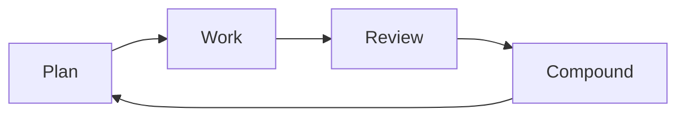

# 🌿 Micrantha

**Engineering resilient software systems.**

Micrantha is an engineering studio and software ecosystem focused on secure, observable platforms and disciplined AI-assisted development. The work explores how software can remain **understandable, operable, composable, and secure** as systems evolve over time.

Core areas include **platform engineering**, **mobile systems**, **infrastructure automation**, **developer tooling**, and **governed agentic development**, with an emphasis on data sovereignty and user-controlled systems.

🌐 [micrantha.com](https://micrantha.com) · [Collaborate](#looking-for-collaborators) · [Projects](#project-families) · [Integration map](../docs/architecture/ecosystem-integration.md) · [Engineering standards](#engineering-standards) · [Contributing](https://github.com/hackelia-micrantha/.github/blob/main/CONTRIBUTING.md)

---

## Looking for collaborators

Micrantha is actively looking for people and organizations that can help turn the ecosystem into durable, useful, independently sustainable software.

- **Project contributors** — engineering, security review, testing, documentation, design, accessibility, packaging, integrations, and field testing across the public projects.
- **A strategic partner** — an organization or individual interested in product direction, open-source sustainability, distribution, applied research, commercialization, or bringing the technology into real operating environments.
- **A co-founder or long-term operating partner** — someone interested in helping shape Micrantha beyond individual repositories, with complementary product, business, research, community, or engineering strengths.
- **Hardware and infrastructure resources** — GPU-capable systems, accelerators, storage, networking equipment, hosted compute/CI capacity, or other resources that can expand local AI, conformance, build, and systems-testing capability.
- **Project adoption and practical feedback** — teams willing to try individual tools, challenge assumptions, contribute real-world requirements, or help validate where the projects are and are not useful.

**Current Anthesis trial need:** Anthesis is specifically looking for existing agentic systems—coding agents, supervisor/specialist systems, MCP/tool workflows, automation platforms, and similar runtimes—for bounded trial runs around one consequential action. The goal is to gather integration, bypass-resistance, policy-model, evidence, approval-UX, and operational feedback, including negative results. See the [Anthesis collaboration section](https://anthesis.micrantha.com/#collaborate).

Support can take the form of time, expertise, equipment, infrastructure, sponsorship, introductions, or direct project work. Collaboration does not bypass project governance, security review, or repository trust boundaries.

For public project work, start with the relevant repository and the organization [contributing guide](https://github.com/hackelia-micrantha/.github/blob/main/CONTRIBUTING.md).

---

## Engineering philosophy

Micrantha treats software as a living ecosystem: systems evolve through design, implementation, observation, review, and refinement rather than a one-time construction effort.

A few principles recur across the projects:

- **Composable by default.** Command-line tools should work cleanly through process boundaries, structured stdin/stdout, meaningful exit semantics, and documented man pages.
- **Explicit authority.** Identity, policy, evidence, execution, provenance, and observation are different concepts; one must not silently mint another.
- **Reproducible where practical.** Environments, inputs, plans, artifacts, and important decisions should be attributable and replayable.
- **Local-first where practical.** Local execution and user-controlled infrastructure are preferred when they materially improve privacy, operability, or resilience.
- **Evidence over assertion.** Logs, signatures, receipts, model output, test results, and observations are evidence inputs, not automatic authorization or product truth.
- **Small durable controls.** Repeated findings should become the weakest reliable control that prevents recurrence: tests, schemas, invariants, safer defaults, CI, policy, or bounded guidance.
- **Trust domains are explicit.** Public/private repositories, mirrors, agent workspaces, recovery stores, and canonical endpoints are modeled as deliberate topology rather than inferred from provider names.

Shared public standards and architecture documentation are available in the [organization repository](https://github.com/hackelia-micrantha/.github).

---

## Project families

This is a curated directory of public project surfaces, not an inventory of all repositories or deployed integrations. Each project documents its own support, release and compatibility boundaries.

### Governed agentic systems

- **[Dubnium](https://github.com/hackelia-micrantha/dubnium-community)** — personal, self-hosted engineering environment and reference use case for local AI and bounded automation. Public contracts and conformance material are incubating; a generally available workstation/runtime distribution is not yet released.
- **[Anthesis](https://github.com/hackelia-micrantha/anthesis-community)** — portable, self-hostable governance for data sovereignty in agentic AI: deterministic policy decisions, capabilities, approvals, evidence, and provenance for consequential effects. Enforcement depends on the integrating tool or runtime controlling bypass paths; Anthesis alone does not guarantee data residency.
- **[Invokrum](https://github.com/hackelia-micrantha/invokrum-community)** — deterministic prompt/context composition, manifests, locks, and exact context identity.
- **[Modolia](https://github.com/hackelia-micrantha/modolia-community)** — deterministic model-surface eligibility and routing decisions; runtime provider execution remains separate.
- **[Keylix](https://github.com/hackelia-micrantha/keylix-community)** — sender-constrained OAuth/DPoP and proof-of-possession primitives.
- **[Sandcastle](https://github.com/hackelia-micrantha/sandcastle-community)** — persistent checkpoint identity and mutable-workspace lineage for disposable execution environments.
- **[Testule](https://github.com/hackelia-micrantha/testule-community)** — portable testability contracts, native-tool adapters, verification requirements, and normalized testing evidence.

### Developer and repository tooling

- **[Repora / `repoctl`](https://github.com/hackelia-micrantha/repora)** — explicit repository topology, observation, exact plans, stale-safe reconciliation, managed artifacts, posture collection, and execution evidence.
- **[Calathea](https://github.com/hackelia-micrantha/calathea-community)** — deterministic portfolio and workflow orientation and prioritization.

### Infrastructure

- **[Hyperion](https://github.com/hackelia-micrantha/hyperion-community)** — reproducible provisioned infrastructure, K3s, and GitOps workload convergence.

### Mobile and edge

- **[Amaryllis](https://github.com/hackelia-micrantha/amaryllis)** — React Native foundation for on-device multimodal inference and governed AI-enabled UI.
- **[Achillea](https://github.com/hackelia-micrantha/achillea-community)** — platform and SDK for guided outdoor experiences.
- **[Bluebell](https://github.com/hackelia-micrantha/bluebell)** — Kotlin Multiplatform SDK/application foundation.
- **[Digitalis](https://github.com/hackelia-micrantha/digitalis-community)** — mobile attestation and backend-authoritative secure-configuration experiments.
- **[Envuscator](https://github.com/hackelia-micrantha/envuscator-community)** — build-time mobile configuration obfuscation and delivery tooling.
- **[Myosotis](https://github.com/hackelia-micrantha/myosotis-community)** — governed field-operated AI tool protocols and SDK architecture.
- **[Morifolium](https://github.com/hackelia-micrantha/morifolium)** — mobile platform-engineering golden path and reference distribution.

### Shared engineering substrate

- **[Phyllotaxis](https://github.com/hackelia-micrantha/phyllotaxis-community)** — shared, themeable design-system contracts for user interfaces.

### Labs and conformance

- **[Anthesis Governance Lab](https://github.com/ryjen/anthesis-governance-lab)** — executable public scenarios and adversarial fixtures for deterministic governance evaluation. Evaluating declared effects does not prove enforcement in an external runtime.
- **[CONTENTPKG](https://github.com/hackelia-micrantha/contentpkg-community)** — research into self-contained digital ownership using encrypted content packages and compact blockchain-backed ownership evidence. MUSICPKG, its first specialization, explores durable offline music ownership and purchaser-controlled recovery. The public MUSICPKG v0.2 Working Draft includes specifications, test vectors, and a bounded Rust reference conformance harness; complete production package verification and end-to-end playback remain unestablished.

### Creative work

- **[Entanglement of Ages](https://github.com/ryjen/entanglement-of-ages-marketing)** — the multi-book creative project, presented through its separately reviewed public marketing surface.

---

## Engineering standards

The [shared standards](https://github.com/hackelia-micrantha/.github/blob/main/docs/standards/README.md) define expectations according to project maturity, risk, and supported surfaces. They are engineering requirements, not a blanket certification of every project.

- **[Testing](https://github.com/hackelia-micrantha/.github/blob/main/docs/standards/testing.md)** — a risk-shaped test pyramid, validation at the lowest trustworthy layer, and explicit gaps. Testule supplies portable contracts and normalized evidence where adopted; native tools execute the tests.
- **[CI/CD](https://github.com/hackelia-micrantha/.github/blob/main/docs/standards/ci-cd.md)** — exact-revision evidence, least-privilege workflows, explicit runner trust, and bounded concurrency.
- **[Releases](https://github.com/hackelia-micrantha/.github/blob/main/docs/standards/releases.md)** — attributable artifacts, integrity verification, supported installation paths, compatibility, and rollback.
- **[Security](https://github.com/hackelia-micrantha/.github/blob/main/docs/standards/security.md)** and **[tool-result trust](https://github.com/hackelia-micrantha/.github/blob/main/docs/standards/tool-result-trust.md)** — explicit trust boundaries and evidence that cannot silently become permission.
- **[CLI interoperability](https://github.com/hackelia-micrantha/.github/blob/main/docs/standards/cli-interoperability.md)** — composable process interfaces, machine output, meaningful exit semantics, and man pages.
- **[Documentation](https://github.com/hackelia-micrantha/.github/blob/main/docs/standards/documentation.md)** — evidence-backed public claims, clear maturity, and reviewed publication boundaries.
- **[Community UI](https://github.com/hackelia-micrantha/.github/blob/main/docs/standards/ui-design.md)** — Phyllotaxis-aligned, content-first Utility interfaces with modern accessibility; Editorial styling where the publishing task warrants it.

See also the [AI-assisted SDLC](https://github.com/hackelia-micrantha/.github/blob/main/docs/engineering/ai-assisted-sdlc.md) and [repository topology and trust domains](https://github.com/hackelia-micrantha/.github/blob/main/docs/architecture/repository-topology-and-trust-domains.md).

## Where to look

- [Micrantha website](https://micrantha.com)
- [Public engineering standards](https://github.com/hackelia-micrantha/.github/blob/main/docs/standards/README.md)
- [Contribution guidance](https://github.com/hackelia-micrantha/.github/blob/main/CONTRIBUTING.md)
